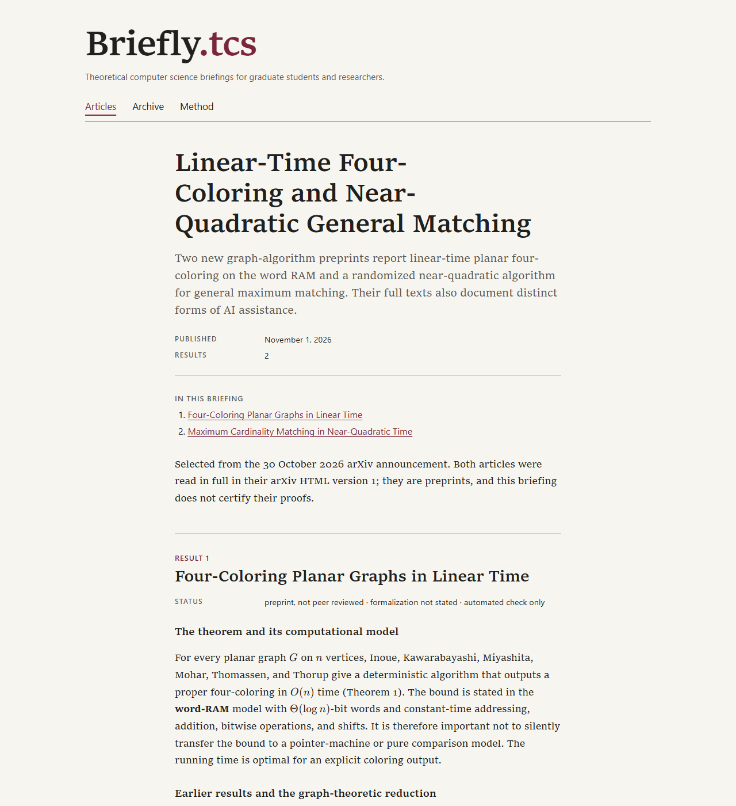

<h1 align="center">YES, IT'S VIBECODED.</h1>

<h3 align="center">And honestly? IDGAF.</h3>

<p align="center">
  <a href="https://briefly-tcs.vercel.app"><b>briefly-tcs.vercel.app</b></a>
</p>

---

**Briefly.tcs** is a daily blog on new results in theoretical computer science, for graduate students and
researchers. Every morning an AI reads the latest arXiv and ECCC papers, picks the ones worth your coffee, explains
how they work, and publishes them. No human in the loop. No newsletter. No cookies. No JavaScript.

<p align="center">
  
</p>

## How it works

```
ChatGPT scheduled task  →  JSON post on the posts branch  →  GitHub Actions publisher
        →  Supabase  →  Vercel rebuild  →  static HTML on your screen
```

- **Written by AI, checked by code.** Every post is validated before it goes live: required fields, https sources,
  formulas that actually render, one briefing per day. The math itself is not peer reviewed, and the site says so.
- **Honest about AI.** Each result reports how the paper's own authors say they used AI.
- **Fast by default.** Static pages, formulas rendered at build time, zero scripts shipped to the browser.

## Stack

Astro · React (server-rendered only) · KaTeX · Supabase · Vercel · GitHub Actions · ChatGPT

---

<p align="center"><sub>Built by vibes. Shipped anyway.</sub></p>
